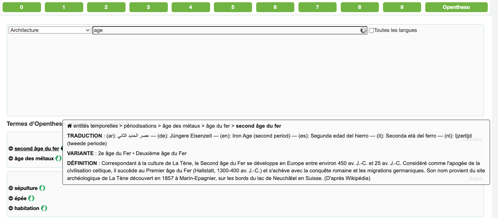

# Plugin Tamil Opentheso

[Opentheso](https://opentheso.hypotheses.org) est une application qui permet
d’interroger, d'enrichir et/ou de corriger les termes consitutant des
thesaurus, de créer les termes et de les placer dans une hiérarchie de termes.
La recherche et l’utilisation des termes ne requiert aucune authentification
préalable. En revanche, un _login_ est impératif pour modifier ou créer des
termes.

L'application Opentheso peut être utilisée via une interface web, ou bien exploitée
directement depuis une autre application de base de données au moyen de
services web. C'est au moyen des services web d'Opentheso que le plugin Tamil
Opentheso fonctionne.

Opentheso a été créé à la demande de la Fédération et ressources sur
l’Antiquité (GDS Frantiq), pour la gestion du thesaurus
[Pactols](https://pactols.frantiq.fr). C'est aujourd'hui un outil générique
proposé dans la grille de services de la TGIR
[Huma-Num](https://www.huma-num.fr). Le plugin Koha Tamil Opentheso a été
développé à la demande de Frantiq et mis à disposition de la communauté des
utilisateurs de Koha.

Le plugin **Tamil Opentheso** permet d'exploiter depuis Koha un ou plusieurs
thesaurus gérés dans un ou plusieurs serveurs Opentheso et de réaliser deux
grandes catégories de tâches :

1. **Catalogage** — Dans les grilles de saisie de Koha, un onglet Opentheso est
   ajouté. Il contient la liste des termes d'Opentheso contenus dans la notice
   MARC. Une barre de recherche permet d'interroger directement des thesaurus
   et de lier des termes à la notice Koha. La forme principale du terme est
   placée dans une sous-zone MARC ($a) et l'identifiant ARK du terme dans une
   autre sous-zone (paramétrable). Les termes sont affichés avec des
   informations extraites des thesaurus : chemin complet du terme dans sa/ses
   hiérarchies ; traductions ; notes et variantes.

1. **Affichage** — Dans les affichages des notices, à l'OPAC et en PRO, les
   termes sont enrichis d'informations extraites des thesaurus.

## Installation

**Activation des plugins** — Si ce n'est pas déjà fait, dans Koha, activez les
plugins. Demandez à votre prestataire Koha de le faire, ou bien vérifiez les
points suivants :

- Dans `koha-conf.xml`, activez les plugins.

Les fichiers statiques du plugin (JS, CSS, images) sont servis par Koha via
`/api/v1/contrib/opentheso/static/...` : aucune configuration d'Apache
(alias `/plugin/...`) n'est nécessaire, à partir de Koha 23.11. La page
d'accueil est rendue en markdown côté navigateur (lib `marked` embarquée) :
aucun module Perl supplémentaire n'est requis.

**📁 TÉLÉCHARGEMENT** — Récupérez sur le site [Tamil](https://www.tamil.fr)
l'archive de l'Extension **[Tamil
Opentheso](https://www.tamil.fr/download/koha-plugin-tamil-opentheso-1.0.1.kpz)**.

Dans l'interface pro de Koha, allez dans `Outils > Outils de Plugins`. Cliquez
sur Télécharger un plugin. Choisissez l'archive **téléchargée** à l'étape
précédente. Cliquez sur Télécharger.

## Configuration

### Paramétrage du plugin

Dans les Outils de plugin, vous voyez l'extension **Tamil Opentheso**.  Lancez
le plugin puis cliquez sur Configurer. Vous y trouverez une zone de saisie
contenant la structure de données, sérialisée en JSON, qui pilote le
fonctionnement du plugin. Notez qu'après l'installation du plugin, les
paramètres sont initialisés par défaut pour lier Koha au thesaurus
[Pactols](https://pactols.frantiq.fr), ainsi qu'à deux autres thesaurus gérés
dans deux autres serveurs Opentheso. C'est une bonne base de travail. Vous
pouvez y revenir en vidant la zone de saisie.

```json
{
  "fields": [
    {
      "tag": "695",
      "ark": "4",
      "name": "Architecture",
      "server": "https://opentheso.huma-num.fr/opentheso",
      "theso": "th366",
      "lang": "fr"
    },
    {
      "tag": "696",
      "ark": "4",
      "name": "Type et matériaux d'inscriptions",
      "server": "https://thesaurus.mom.fr/opentheso",
      "theso": "4",
      "group": "MT94,MT_13",
      "lang": "fr"
    },
    {
      "tag": "697",
      "ark": "4",
      "name": "Lieu",
      "server": "https://pactols.frantiq.fr/opentheso",
      "theso": "th17",
      "lang": "fr"
    },
    {
      "tag": "698",
      "ark": "4",
      "name": "Époque",
      "server": "https://pactols.frantiq.fr/opentheso",
      "theso": "TH_1",
      "group": "G124",
      "lang": "fr"
    },
    {
      "tag": "699",
      "ark": "4",
      "name": "Sujet",
      "server": "https://pactols.frantiq.fr/opentheso",
      "theso": "TH_1",
      "group": "G116,G126,G122,G173,G128,G137,G120,G135,G118,G130,G132",
      "lang": "fr"
    }
  ],
  "catalog": {
    "enable": 1,
    "mask": 1
  }
}
```

- **fields** — C'est un tableau des champs liés à un thesaurus Opentheso :
  - **tag** — Le tag de la zone MARC où le terme est placé. Le terme retenu est
    placé dans la sous-zone **$a** de cette zone.
  - **ark** — La sous-zone dans laquelle recopier l'identifiant ARK du terme. En
    général, c'est un code **$4** ou **$0**.
  - **name** — Le nom du thesaurus, tel qu'il sera présenté par le plugin.
  - **server** — L'URL du serveur Opentheso.
  - **theso** — Le code du thesaurus.
  - **group** — Information facultative. Si absent, tout le thesaurus est
    utilisé, sinon le plugin utilse les collections (ou groupes) listées ici
    (séparées par des virgules).
  - **lang** — Le code langue (fr, en) à utiliser. Les termes seront affichés
    dans cette langue. Les termes retenus seront dans cette langue.
- **catalog** — Les paramétres d'utilisation du plugin en catalogage Koha.
  - **enable** — Active ou non le plugin sur la page de catalogage.
  - **mask** — Masque les champs de catalogage _classiques_.

### Paramétrage de Koha

Pour utiliser le plugin Tamil Opentheso, ajoutez des zones MARC spécifiques à
vos grilles de catalogage. Moifiez vos feuilles de styles XSL pour afficher les
nouvelles zones. Enfin, révisez le paramétrage du moteur d'indexation.

Vous créez par exemple une zone **699** pour la lier à un thesaurus **Sujet**.
La zone 699 doit contenir deux sous-zones, une première pour le terme retenu et
une seconde pour son identifiant ARK. Ce serait par exemple :

- `$a` : Sujet
- `$4` : ARK

Pour afficher cette nouvelle zone, vous modifiez vos feuilles de style XSL, OPAC
et PRO. Par exemple pour l'OPAC, créez un template que vous appelez ensuite
depuis la feuille de style de la page de détail :

```xml
<xsl:template name="tag_opentheso">
  <xsl:param name="tag"/>
  <xsl:param name="label"/>
  <xsl:if test="marc:datafield[@tag=$tag]">
    <span class="results_summary">
      <span class="label">
        <xsl:value-of select="$label"/>
        <xsl:text> : </xsl:text>
      </span>
      <xsl:for-each select="marc:datafield[@tag=$tag]">
        <a>
          <xsl:attribute name="href">
            <xsl:text>/cgi-bin/koha/opac-search.pl?q=an:</xsl:text>
            <xsl:value-of select="marc:subfield[@code=4]"/>
          </xsl:attribute>
          <xsl:attribute name="class">
            <xsl:text>ark</xsl:text>
          </xsl:attribute>
          <xsl:for-each select="marc:subfield[@code='a']">
            <xsl:value-of select="."/>
          </xsl:for-each>
          <xsl:if test="not(marc:subfield[@code='a'])">
            <xsl:text>Pas de terme</xsl:text>
          </xsl:if>
        </a>
        <xsl:if test="not (position()=last())">
          <xsl:text> ; </xsl:text>
        </xsl:if>
      </xsl:for-each>
    </span>
  </xsl:if>
</xsl:template>
```

## Catalogage

Dans le module de catalogage de Koha, un nouvel onglet Opentheso est affiché.
Il contient une section de recherche et une section d'affichage.

- Dans la section de recherche, vous pouvez sélectionner un thesaurus dans une
  boîte de liste. Dans une zone de saisie, vous entrez une expression de
  recherche. La recherche est lancée en pressant la touche Entrée. Le résultat
  est affiché. En survolant les termes, une info-bulle est affichée qui permet
  de replacer le terme dans sa hiérarchie, de voir ses traductions, et diverses
  informations complémentaires.

- Dans la section d'affichage, les termes Opentheso liés à la notice sont
  affichés. Ils sont regroupés par thesaurus. En survolant chaque terme, une
  info-bulle est affichée qui présente des informations complémenaires. Devant
  chaque terme, une icône permet de retirer le terme de la notice. Une autre
  icône permet d'ouvrir un onglet présentant le terme dans le serveur Opentheso
  relié.



## VERSIONS

* **1.1.0** / novembre 2026 — Fichiers statiques servis via
  `/api/v1/contrib/opentheso/static/` (plus besoin d'alias Apache `/plugin`) ;
  rendu markdown en JS côté navigateur (plus de dépendance `Pithub::Markdown`)
* **1.0.1** / février 2023 — Version initiale

## LICENCE

This software is copyright (c) 2023 by Tamil s.a.r.l..

This is free software; you can redistribute it and/or modify it under the same
terms as the Perl 5 programming language system itself.

